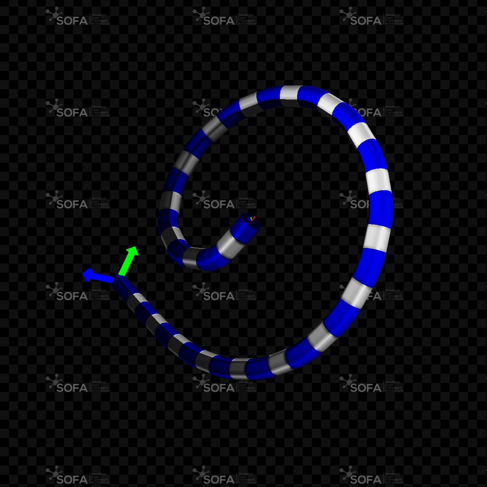
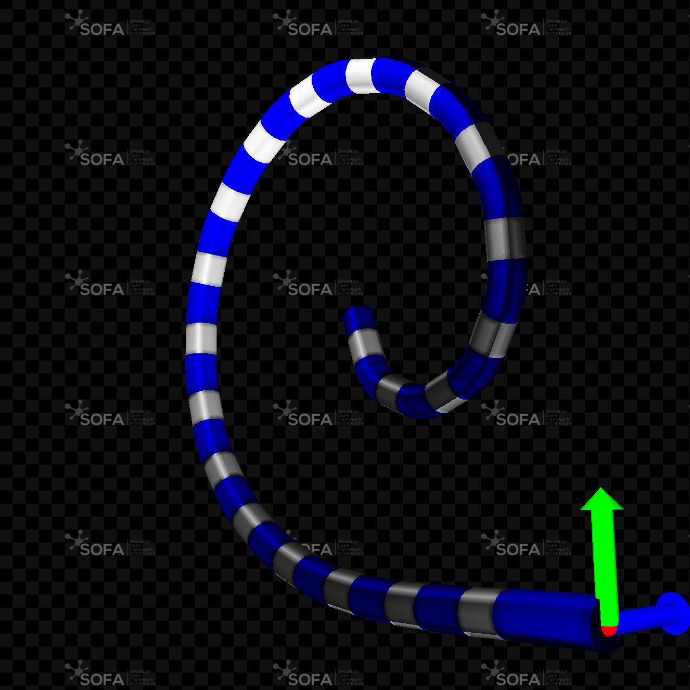
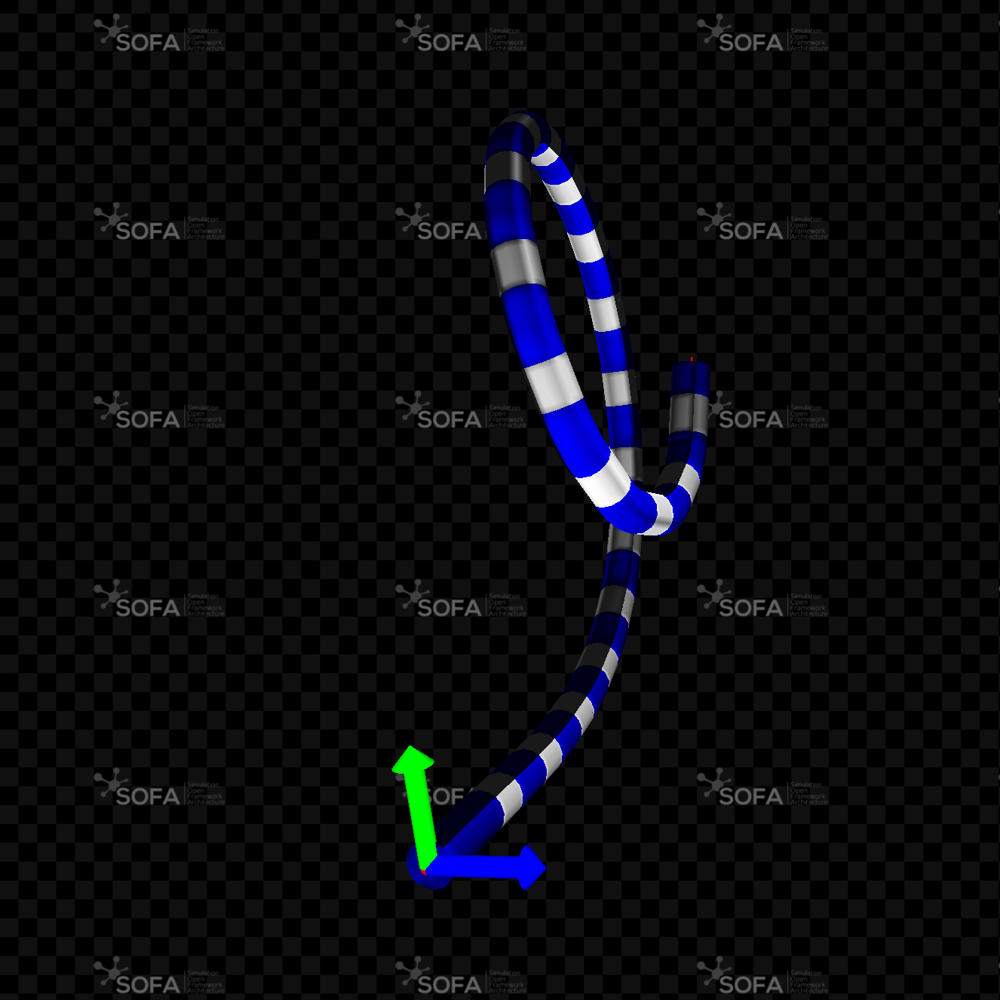
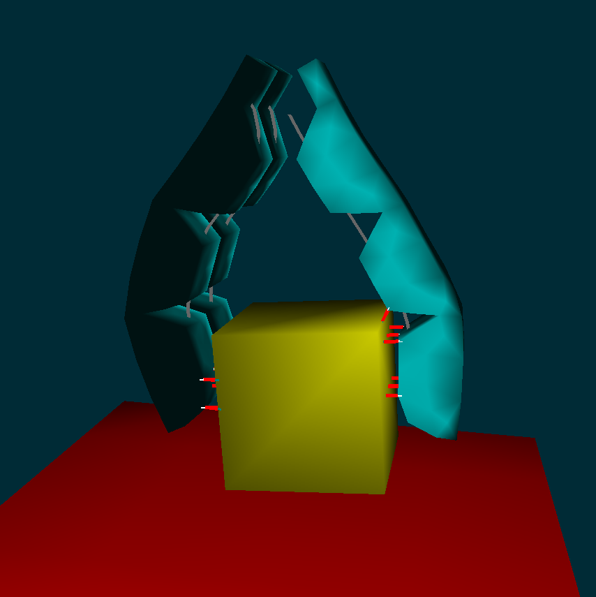
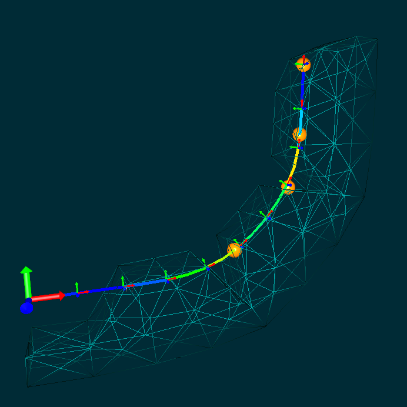
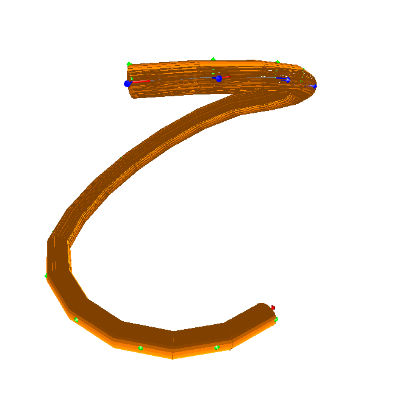
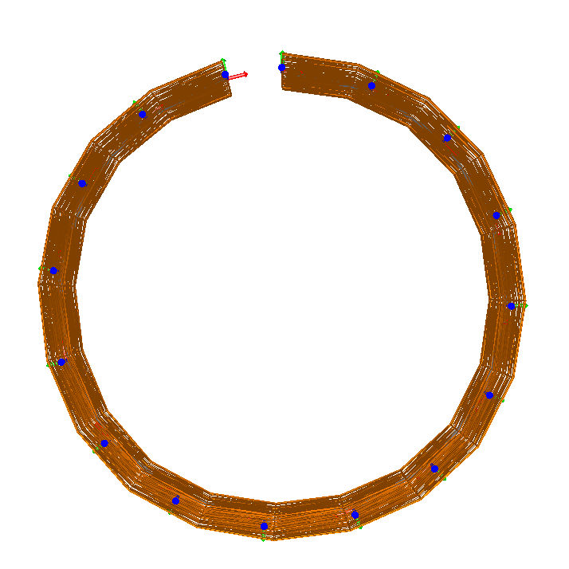
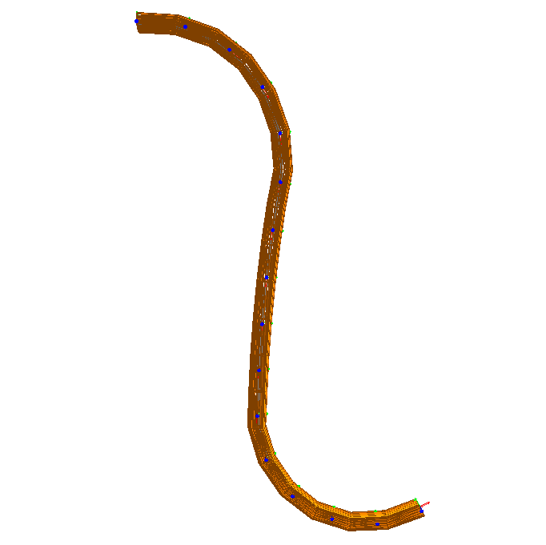
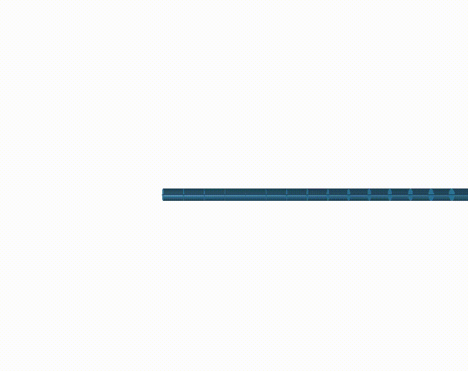

# Cosserat Plugin

## Overview

An open-source plugin compatible with the [SOFA framework](https://www.sofa-framework.org) for simulating 1D objects. It enables modeling of rigid and flexible 1D entities such as rods, wires, or needles using Cosserat beam theory. You can create scenes in Python or XML, or develop new C++ components. Contributions are welcome!

## Theory and Background

The Cosserat model simulates deformation of robot bodies with rod-like geometry and mechanical properties. It replicates nonlinear deformations including bending, torsion, extension, and shearing.

Key feature: each material point is treated as a rigid body with 6 degrees of freedom (3 translations + 3 rotations), unlike traditional models that treat points as particles with 3 translations.

This creates a framework similar to articulated solids, where relative positions are defined by strain states. It is well suited to modeling concentric tube robots, cable-actuated continuum robots, or pneumatic soft robots with constant cross-sections.

For theoretical details: [Theory](examples/python3/tutorial/Writerside/topics/Theory.md). The strain convention used in the code is described in [STRAIN_CONVENTION.md](src/liegroups/STRAIN_CONVENTION.md).

## Features

### Piece-wise Constant Strain (PCS)
The main model of the plugin. The beam is split into sections, each with a constant strain (torsion, bending, elongation, shear). It is based on:
- **Discrete cosserat approach for soft robot dynamics: A new piece-wise constant strain model with torsion and shears** [Link](https://ieeexplore.ieee.org/document/7759808)
- **Coupling numerical deformable models in global and reduced coordinates for the simulation of the direct and inverse kinematics of Soft Robots** [Link](https://hal.archives-ouvertes.fr/hal-03192168/document)

  

Main components (see the READMEs in [`src/Cosserat/mapping`](src/Cosserat/mapping/README.md) and `src/Cosserat/forcefield` for details):

| Kind | Components |
|------|------------|
| Mappings | `DiscreteCosseratMapping`, `DiscreteDynamicCosseratMapping`, `Strain2FramesCosseratMapping`, `Frames2StrainCosseratMapping`, `DifferenceMultiMapping`, `RigidDistanceMapping` |
| Force fields | `BeamHookeLawForceField`, `HookeSeratPCSForceField` (and their `Rigid` variants) |
| Constraints | `CosseratActuatorConstraint`, `CosseratSlidingConstraint`, `CosseratNeedleSlidingConstraint`, `QPSlidingConstraint` |

### Lie group library
The `src/liegroups` folder contains an internal Lie group library used by the mappings and force fields: `SO2`, `SO3`, `SE2`, `SE3`, `SE23`, `SGal3` and `Bundle`, together with Jacobians, BCH, interpolation and geometric integrators. It also contains tools built on top of it: trajectory optimization, an iLQR controller and parameter calibration for Cosserat rods. Unit tests are in `src/liegroups/Tests`, and the audit report is in [AUDIT_LIEGROUPS.md](src/liegroups/docs/AUDIT_LIEGROUPS.md).

### Articulated rigid bodies
`KinematicChain` describes kinematic trees (one parent per segment) with per-segment Jacobians, and is exposed to Python through the standalone `articulated_rigids` module (see [python-bindings](docs/python-bindings.md)). `KinematicChainMapping` maps joint coordinates and a rigid base to rigid frames in SOFA (`apply`, `J`, `J^T`, and constraint `J^T`), with dynamics on the mapped frames through `RigidBodyMass`.

### Staggered (Painless) discretization — experimental
An alternative discretization where positions live on the nodes (`Vec3`) and rotations on the middle of the edges (`SO3`), following *Painless Differentiable Rotation Dynamics* (Romanyà-Serrasolsas, Casafranca, Otaduy, ACM ToG / SIGGRAPH 2025, [DOI 10.1145/3730944](https://doi.org/10.1145/3730944)). It is implemented by `PainlessBeamForceField` and `StaggeredCosseratMapping`. Forces and torques are exact, but the tangent stiffness is not complete yet, so only explicit integration is supported. Python scenes are in [`tutorials/advanced/staggered`](tutorials/advanced/staggered).

### Piece-wise Non-constant Strain *(planned)*
Allow the strain to vary continuously within each beam section, for a more accurate description of complex deformations than the constant strain assumption. Useful for beams with varying material properties or under non-uniform loads.

### DCM with Plastic Model *(planned)*
Extend the Discrete Cosserat Model (DCM) to plastic behavior, to simulate permanent deformations in materials that exceed their elastic limit.

## Use Cases and Applications

### Cochlear Implant Modeling
Using the Discrete Cosserat Model (DCM):

| View 1 | View 2 | View 3 |
|--------|--------|--------|
|  |  |  |

### Cable Modeling for Deformable Robot Control

| Soft gripper simulation | Model convergence study |
|-------------------------|-------------------------|
|  |  |

### Actuation Examples
DCM beam actuated by cables:

| Cable actuation 1 | Cable actuation 2 | Cable actuation 3 |
|-------------------|-------------------|-------------------|
|  |  |  |

### Animation Examples

| Example 1 | Example 2 |
|-----------|-----------|
|  |  |

## Getting Started

1. Install SOFA (v24 or later) with the SofaPython3 plugin, and build this repository as a SOFA plugin (C++17).
2. Follow the setup tutorial: [Tutorial 00 — Introduction and setup](tutorials/getting_started/tutorial_00_introduction_and_setup.md).
3. Continue with the step-by-step tutorials in [`tutorials/getting_started`](tutorials/getting_started) (discretization, gravity, constraints, contact, curved beams, hybrid modeling) and read the [tutorial guide](tutorials/TUTORIAL_GUIDE.md).

The full Cosserat tutorial is also available here: [Cosserat Tutorial](tutorials/documentation/text/cosserat_tutorial.md).

## Repository Layout

| Path | Content |
|------|---------|
| `src/Cosserat` | SOFA components: mappings, force fields, constraints, engines |
| `src/liegroups` | Lie group library, kinematic chains, optimization and control tools, Python bindings, tests |
| `tutorials` | Tutorial scenes: `getting_started`, `intermediate`, `advanced` (needle, staggered) |
| `examples` | Python examples and the Python helper package |
| `docs` | Documentation and images |

## Publications

1. **Discrete cosserat approach for soft robot dynamics: A new piece-wise constant strain model with torsion and shears**  
   [IEEE Link](https://ieeexplore.ieee.org/document/7759808)

2. **Coupling numerical deformable models in global and reduced coordinates for the simulation of the direct and the inverse kinematics of Soft Robots**  
   [IEEE Link](https://ieeexplore.ieee.org/abstract/document/9362217)  
   [PDF Download](https://hal.archives-ouvertes.fr/hal-03192168/document)

3. **Painless Differentiable Rotation Dynamics** (staggered discretization)  
   [DOI 10.1145/3730944](https://doi.org/10.1145/3730944)

## Contributing

We welcome contributions! Please open an issue or a pull request. For questions, use [GitHub Discussions](https://github.com/sofa-framework/sofa/discussions/categories/cosserat) or the [Gitter room](https://app.gitter.im/#/room/#sofa-framework_cosserat-needle-insertion:gitter.im).

## License

This plugin is distributed under the [GNU LGPL v3](LICENSE).
